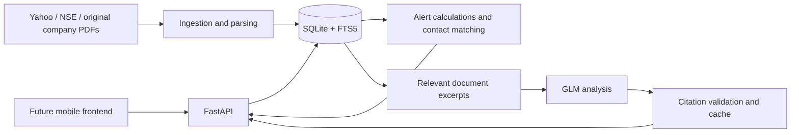

# FINN backend

A working backend for the ENAM build challenge. Python/FastAPI handles the API, SQLite stores the data and searchable document chunks, and a configurable GLM adapter produces cited research. No frontend or cloud deployment is included yet.

## Run locally

Requires Python 3.11+ and [uv](https://docs.astral.sh/uv/).

```sh
uv sync --python python3.12
cp .env.example .env
uv run uvicorn finn.main:app --host 127.0.0.1 --port 8000 --reload
```

Open http://127.0.0.1:8000/docs for the interactive API. Health: http://127.0.0.1:8000/health.

Add your Hyde-issued key as `FINN_GLM_API_KEY` in `.env`, then restart. The current working baseline uses `FINN_GLM_BASE_URL=https://inference.hyde.tech/v1` and `FINN_GLM_MODEL=hyde/glm-5.3-flash`, following the [Hyde quickstart](https://inference.hyde.tech/docs/quickstart). Hyde keys must be sent to the Hyde gateway. FINN has no GLM-only restriction: providers/models per task, including smaller models for efficiency, will be decided with the user after workflow validation (see PLAN.md). The existing adapter accepts OpenAI-compatible chat-completions APIs; other API formats will need an adapter. Keys are read by the backend only, never returned to API clients or committed.

With no key, research returns relevant source excerpts with `status=evidence_only`. It does not pretend a generated answer exists. A missing corpus returns `status=needs_sources`.

## Try the complete demo

```sh
curl -X POST http://127.0.0.1:8000/api/demo/seed
curl 'http://127.0.0.1:8000/api/digest?mode=demo&include_routine=true'
curl -X POST http://127.0.0.1:8000/api/research \
  -H 'Content-Type: application/json' \
  -d '{"ticker":"TCS","question":"Compare management margin guidance with delivered margins across the available quarters.","mode":"demo"}'
curl 'http://127.0.0.1:8000/api/network/recommendations?symbol=TCS'
curl 'http://127.0.0.1:8000/api/network/recommendations?person_id=demo-arjun'
```

The seed adds an 18-company portfolio only if the portfolio is empty. It adds six fictional contacts, synthetic daily prices and announcements, and synthetic reports/transcripts for TCS, INFY, TITAN plus CDSL, COFORGE and DIXON for off-portfolio research. Repeating the seed updates demo fixtures without duplicating documents or contacts. Real company names do **not** make these financial figures real. `mode=demo` is explicit; live queries never fall back to these records. Synthetic contacts are labelled in recommendations, including when they overlap with live companies.

## API contract

### Inspect one complete fictional workflow

Run this without a server or API key:

```sh
PYTHONPATH=. uv run python scripts/check_workflow.py > /tmp/finn-workflow.json
```

This uses a temporary database, exercises the actual API and document retrieval, and mocks only
the model HTTP response. The JSON contains the Push event, retrieved excerpts, model request,
cited answer, chosen contacts with scores/reasons, and pass/fail checks. It does not change your
portfolio or local database. The scripted answer checks wiring, not model reasoning.

The fictional company `MOCKIT` has Q1 guidance for Q2 EBITDA margin of 22% and Q2 delivered margin
of 20%. Its appointment filing links to a fictional incoming CFO. Both the filing and research
select Ananya (industry expert), Vikram (current employee), and Neha (recorded connection to the CFO).
An unrelated agriculture contact is excluded. Vikram's employment overlap is explicitly unverified.
The person ID is supplied in the fixture; automatic identification of executives is still future work.

To run the same scenario against your configured GLM account, with possible model usage charges:

```sh
PYTHONPATH=. uv run python scripts/check_workflow.py --live-model > /tmp/finn-workflow-live.json
```

The live run also uses a temporary database. Review whether its findings accurately cite the
retrieved Q1/Q2 excerpts, distinguish guidance from actual performance, and explain missing Q3
guidance. Citation-ID checks alone do not establish factual accuracy.

To explore the scenario in the running API, call `POST /api/demo/workflow`. This adds the fictional
company to your portfolio and seeds its contacts/documents; repeated calls preserve contact edits
and replace the scenario's filing. Send its returned `research_request` to `POST /api/research`,
and read `GET /api/digest?mode=demo` for the Push event.

Research accepts an optional `person_id` for recorded relationships and `include_trace=true` to
return the prepared model request, retrieved document/chunk counts, and whether a model call
actually happened. Evidence-only and cached answers have `model_called=false`. The prepared
request contains the question and document excerpts, without API credentials or contact profiles.
Network selection remains rule-based and returns `match_types`, scores and reasons independently
of model generation. Announcement imports can supply `subject_person_id` to use the same person
context in Push suggestions.

### Routes

All `/api/*` routes require a bearer token when `FINN_API_TOKEN` is set. No token means local development mode, for one investor, bound to localhost. The schema is also available at `/openapi.json`.

| Endpoint | Purpose |
| --- | --- |
| `GET /health` | Database health and configuration flags, without secrets |
| `GET / PUT /api/portfolio` | Read or replace the portfolio |
| `GET / PUT /api/alerts/settings` | Price threshold, volume threshold/lookback, material categories |
| `GET /api/digest` | Prioritised filing digest and calculated EOD alerts, with embedded contacts |
| `POST /api/announcements` | Import a filing and classify it using explicit keyword rules |
| `POST /api/prices` | Import completed daily price/volume observations |
| `GET /api/companies/{symbol}/prices` | Stored price history |
| `POST /api/refresh` | Queue live market/filing refresh; returns a run ID |
| `GET /api/refresh`, `GET /api/refresh/{id}` | Inspect refresh history, progress and source failures |
| `GET /api/companies/{symbol}/discover` | Discover annual-report and transcript links via Screener |
| `POST /api/documents` | Ingest an original PDF URL or pasted primary-source text |
| `GET /api/documents` | List indexed documents, optionally by `symbol` and `mode` |
| `DELETE /api/documents/{id}` | Delete document, chunks and cached analysis |
| `POST /api/research` | Source-grounded research with citations and relevant contacts |
| `GET / POST /api/network` | List or create contacts |
| `PUT / DELETE /api/network/{id}` | Update or delete a contact |
| `GET /api/network/recommendations` | Match by `symbol`, `theme`, or a target `person_id` |
| `POST /api/demo/seed` | Seed explicitly synthetic demonstration data |
| `POST /api/demo/workflow` | Seed a focused fictional Push/Pull/network scenario and return its research request |

`since` and `until` on the digest must include timezones; the default is the preceding 24 hours. Routine filings are counted but hidden unless `include_routine=true`. Categories can be overridden on import. Classification and summaries are explicitly labelled as rule-based and filing-title-based, respectively.

### Ingest and research a real company

```sh
curl -X POST http://127.0.0.1:8000/api/refresh \
  -H 'Content-Type: application/json' -d '{"tickers":["TCS"],"days":7}'
curl http://127.0.0.1:8000/api/companies/TCS/discover
```

Discovery returns links; it does not automatically download every report. Select useful annual reports and the latest four quarterly transcripts, confirm their dates, and ingest the originals. Add the exact official IR host to `FINN_DOCUMENT_HOSTS` if necessary. There is no ticker-specific research logic.

Example pasted-source ingestion (replace the illustrative text with actual source material):

```json
{
  "ticker": "TCS",
  "kind": "transcript",
  "title": "Company earnings call, quarter and year",
  "published_on": "2026-10-15",
  "url": "https://official-company-host.example/transcript.pdf",
  "text": "Paste the actual primary-source transcript here, at least 50 characters.",
  "mode": "live"
}
```

Send this to `POST /api/documents`. Omit `text` to download the URL as a PDF instead. For downloaded PDFs, citations preserve page numbers. For pasted text, page is `null`. The caller is responsible for providing authentic primary sources; the service cannot authenticate pasted text. Downloads require HTTPS, an exact allowed host and public DNS addresses; redirects are checked and downloads are limited to 20 MB. OCR and encrypted PDFs are not supported.

Then call `POST /api/research` with `{"ticker":"TCS","question":"What was guided versus delivered?"}`. Each generated finding includes citation IDs pointing to returned source excerpts. Unknown or missing citation IDs and invalid JSON are rejected. This verifies the reference structure, not the truth of every model sentence; investor review remains necessary. A question can be answered only to the extent covered by the indexed corpus and retrieved excerpts.

## How the backend works



- **Prices:** Yahoo daily chart adapter; today's bar is excluded so an intraday quote is never treated as a completed day. Price alerts compare consecutive stored closes. Volume alerts compare the latest day with the preceding N trading observations, excluding that day, and require the full lookback. Bars are not adjusted for all corporate actions; investigate split-driven alerts.
- **Announcements:** NSE adapter with cookie bootstrap; deterministic deduplication and category rules. A blocked or changed provider yields a visible failure. BSE price suffixes are supported; automatic BSE filings are not yet implemented, so use announcement import for those.
- **Fundamentals:** Screener discovers links, while original PDFs/text supply the research corpus. Parsing and indexing are deterministic. SQLite FTS5 retrieves chunks across documents; no embedding API is needed. Replacing a document atomically updates its search index. No news or broker research is fetched for Pull.
- **Model:** Only research generation calls GLM. No autonomous actions, web tools or contact messaging. The prompt treats documents as untrusted evidence, and source excerpts—not the entire corpus—are sent. Contact profiles are not sent to GLM. Cache keys include the question, retrieved source content, prompt version, model and endpoint. Network suggestions are recalculated on every request.
- **Network:** Explicit employment tickers, expertise tags, recorded connection edges, and temporal employment overlaps. An overlap is not proof of acquaintance. No LinkedIn scraping, name-based identity guessing, or invented second-degree links. Incoming-person profiles must be provided before their relationships can be queried.
- **Refresh:** Manual background jobs, with optional interval polling via `FINN_REFRESH_INTERVAL_SECONDS`. Use one server worker. Job progress is persisted; jobs interrupted by restart are marked accordingly. This is not a distributed durable queue. Scheduling refreshes updates stored data; phone notification delivery is a future frontend/infrastructure task.

## Privacy and deployment boundary

This version stores **one investor's** portfolio and network in one local database. `FINN_API_TOKEN` protects that instance; it is not multi-user authentication. It stores contact names, supplied career/education/expertise, explicit relationship IDs, provenance, notes and optional last-contact dates. Data stays until deleted; contact deletion also removes inbound relationship edges. Document deletion clears research caches. SQLite files and backups may retain deleted bytes until maintenance and backup expiry.

The database is not encrypted at rest by this application. Keep its directory private and use host disk encryption. Before a shared/production deployment, add real authentication and tenant isolation, TLS, rate limits, provider/consent policy checks, retention and backup deletion, a persistent worker queue, monitored source freshness, and appropriate managed storage. None of those cloud choices are required to run locally. Public repositories should contain only code, synthetic fixtures and the lockfile; `.env`, database files and private network data are ignored.

## Validation

```sh
uv run pytest -q
uv run ruff check finn tests scripts
PYTHONPATH=. uv run python scripts/check_sources.py TCS
```

The default suite uses a temporary real SQLite database and mocked external HTTP responses. It checks exact alert calculations, lookback rules, live/demo separation, document replacement/deletion, contact relationships, authentication, URL restrictions, partial refresh failure, invalid citations, cache invalidation and API schemas. These checks isolate backend behaviour; they do not prove that a live model follows the prompt.

Run the real-model acceptance suite explicitly (uses the current `.env` provider/model and spends tokens):

```sh
FINN_RUN_LIVE_TESTS=1 uv run pytest tests/test_live_workflow.py -q --junitxml=/tmp/finn-live-results.xml
```

The seven cases check two different margin misses and a beat, correct source-linked percentages
and percentage-point differences, stated causes, Q1/Q2 retrieval, unrelated-company exclusion,
the three expected contacts and relationship types, missing forecasts, cache reuse, fresh analysis
after source replacement, document prompt injection, and no model call when sources are absent.
The live tests use the actual API, SQLite, retrieval and configured model HTTP calls; no model
response is mocked. A missing key or provider/schema error fails an explicitly enabled live run.
Each case writes `observations.json` with imported fixtures and research requests/responses to its
pytest temporary directory; `--basetemp` can select a fresh directory for inspection. Credentials
and HTTP auth headers are excluded. The XML contains test outcomes.

These are bounded acceptance checks against known synthetic facts, not a universal factuality
judge or evidence of reliable real-company ingestion. Assertions accept ordinary phrasing variants;
historical figures are allowed in missing-evidence answers when supported by their cited sources.
Review the saved answers and add cases from real documents before claiming broader reliability.
Providers used for research must support strict `json_schema` structured output. Invalid output
and unknown citations still fail validation. Changing the output contract invalidates old analysis caches.

The read-only source check is separate because external sites can rate-limit, block requests or change response formats. Default tests skip the paid live suite; report offline and live results separately.

## Deliberately left for the next stage

The frontend and mobile interaction design; real portfolio source coverage; automatic document selection/refresh; extraction of results tables into verified Revenue/EBITDA/PBT/PAT QoQ/YoY comparisons; incoming-management biographies/entity resolution; advanced financial comparison across four quarters; notification delivery; stronger retrieval evaluation; and production hosting/privacy infrastructure. The current research endpoint can discuss these metrics when they appear in supplied excerpts, but it is not yet a verified financial calculation engine.
